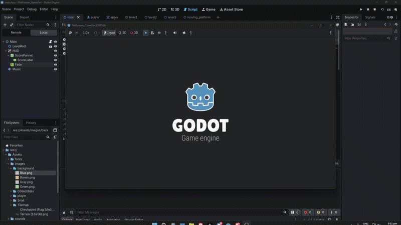
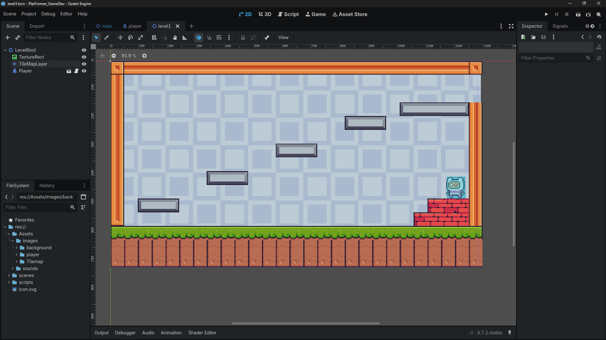
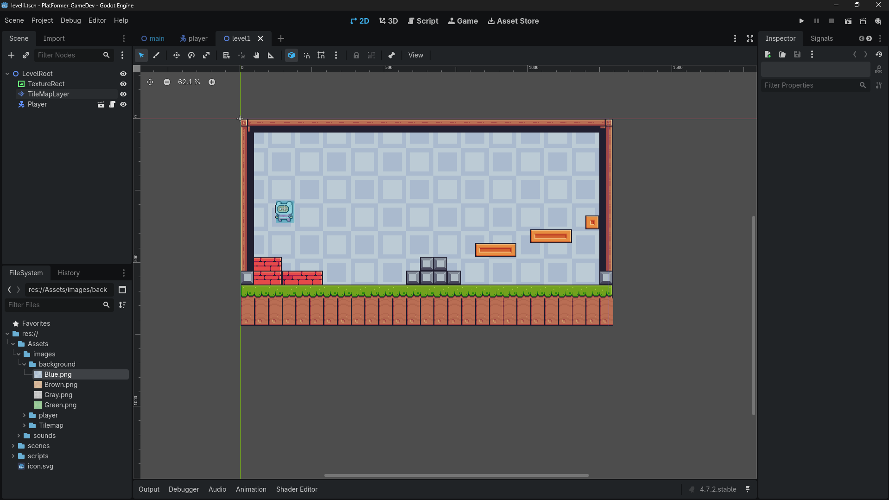
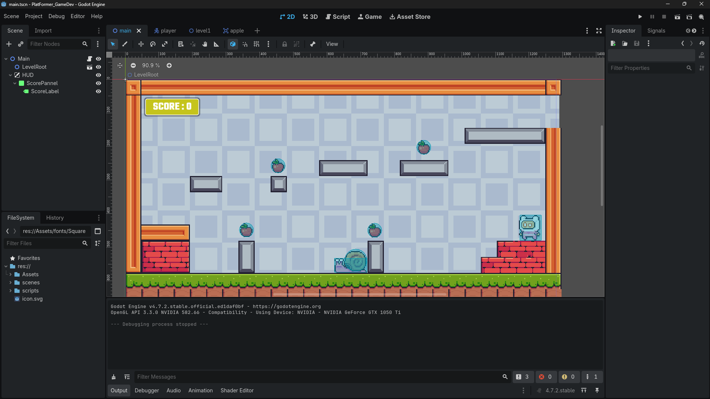
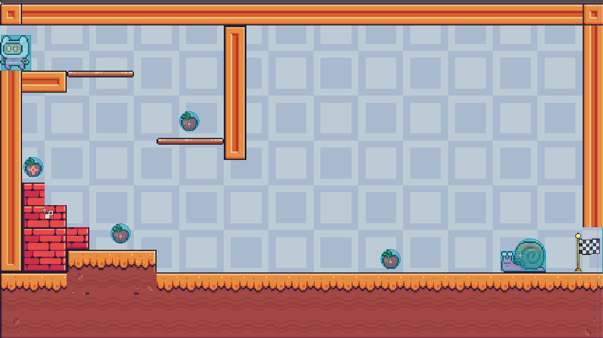
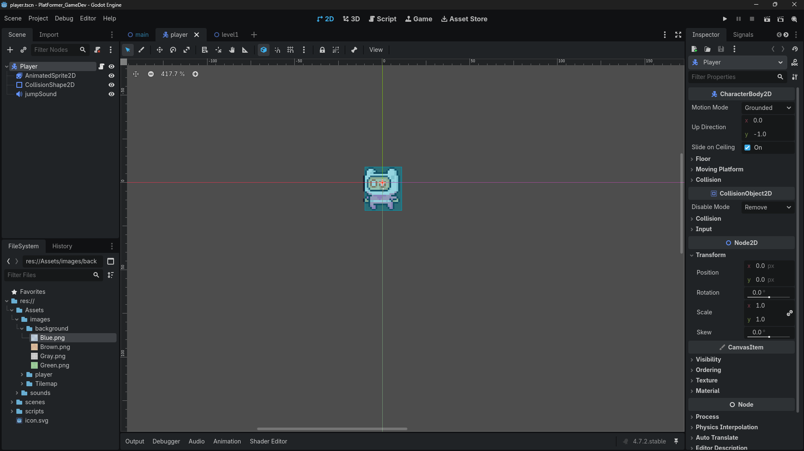
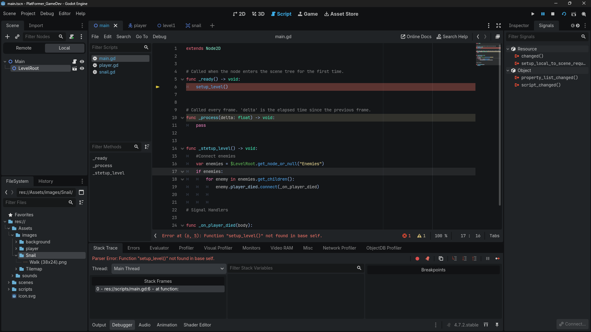
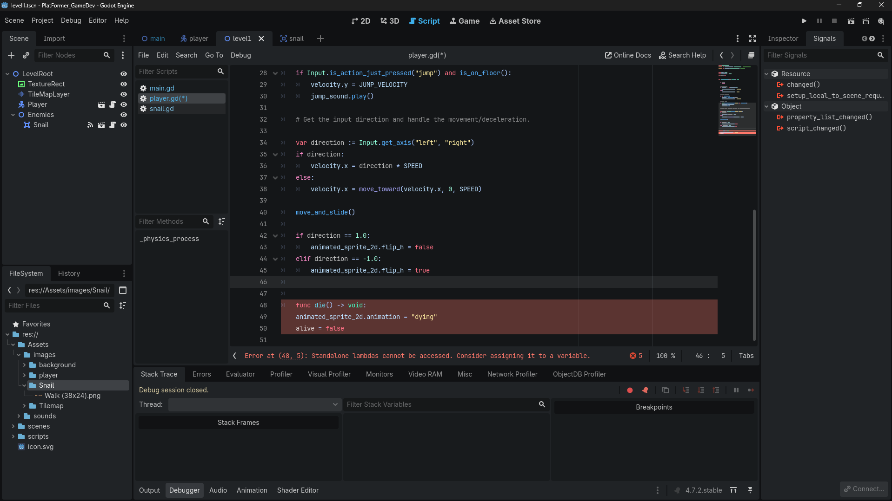
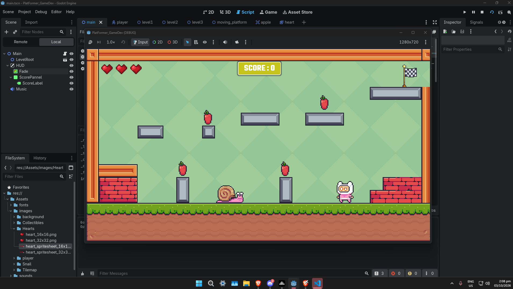
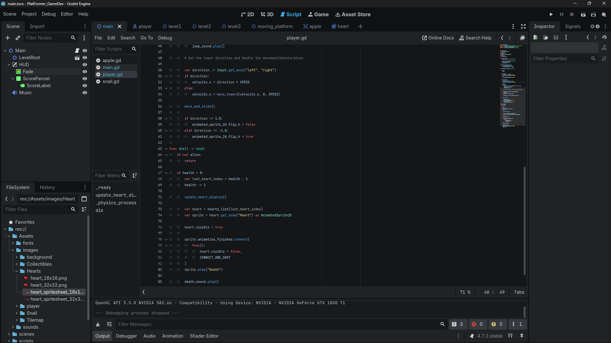

# 2D Platformer

## CS-5105N Game Development

### Weekly Activities — Godot Game Development

## 1. Introduction

This project focuses on developing a 2D platformer game using the Godot game engine. The project was developed through weekly activities covering project setup, gameplay mechanics, level design, animation, particles, user interface, and audio.

The game is designed to let the player move through platform-based levels, avoid enemies, and collect items.

## 2. Game Concept

**Game Title:** 2D Platformer

**Genre:** 2D Platformer

**Game Engine:** Godot 4

The game is a 2D platformer where the player navigates through levels by moving and jumping across platforms. The player can collect apples and encounter enemies while progressing through the game.

The project is being developed incrementally, with each weekly activity introducing new gameplay features and improvements.

## 3. Godot Project Setup

The project was created using Godot 4. The project contains separate folders for assets, scenes, and scripts to organize the game's resources and functionality.

### Project Files

The project includes the following folders and files:

- `Assets` — Game assets and resources.
- `scenes` — Game levels and reusable scenes.
- `scripts` — Scripts that control gameplay and game logic.
- `.gitignore` — Excludes unnecessary generated files.
- `.gitattributes` — Configures Git attributes and Git LFS tracking.
- `project.godot` — Main Godot project configuration.

## 4. Week 1 — Godot & Git Setup

### Objective

This activity focused on setting up the Godot development environment, creating the project structure, and configuring Git and GitHub for version control.

### Project Setup

A new Godot 4 project was created for the 2D platformer. The project was organized into folders for scenes, scripts, and assets.

### Git and GitHub Setup

Git was initialized in the project directory and connected to a personal GitHub repository.

A `.gitignore` file was added to exclude generated Godot files, while `.gitattributes` was used to configure Git LFS for large assets.

The project was committed and pushed to GitHub to maintain a history of development.

## 5. Week 2 — Gameplay Mechanics & Game Feel

### Objective

This activity focused on implementing the player's movement and jumping mechanics and making the controls responsive during gameplay.

### Player Mechanics

A `CharacterBody2D` was used to create the player character. A script was added to handle horizontal movement, jumping, and gravity.

### Player Controls

| Key | Action |
|---|---|
| A / Left Arrow | Move Left |
| D / Right Arrow | Move Right |
| Space | Jump |

### Collision and Interaction

Collision detection was implemented to allow the player to interact with platforms and other game objects.

### Game Feel

Player animations and sound effects provide feedback during gameplay. Additional visual effects are used to make interactions more noticeable.

## 6. Week 3 — Level Design

### Objective

This activity focused on creating two playable levels, adding obstacles and enemies, and introducing a gradual increase in difficulty.

### Level 1

Level 1 introduces the player to the basic platforming mechanics, including movement and jumping. Platforms, obstacles, and a level exit provide the player with a path through the level.

### Level 2

Level 2 builds on the first level by introducing additional challenges, including enemies and collectible apples.

### Level Transition

A level transition system was implemented to allow the player to proceed to the next level after reaching the exit.

### Difficulty Progression

Level 1 introduces the basic controls and platforming mechanics. Level 2 expands on these mechanics by adding more challenges and collectibles.

### Level 3

Level 3 expands on the previous levels with challenging obstacle spacing, moving platforms, collectible placements, and enemy encounters, serving as the advanced stage of the platformer.

## 7. Week 4 — Art, Animation & Particles

### Objective

This activity focused on bringing the game to life through character animations, feedback particle effects, and responsible integration of an AI-generated art asset.

### Player Animations

The player character uses `AnimatedSprite2D` to display distinct animations based on the player’s physics state and gameplay events:

- **Idle:** Played when horizontal velocity is near zero and player is on the floor.
- **Running:** Played when the player is moving horizontally across platforms.
- **Jumping:** Triggered when the player is airborne or moves vertically.
- **Dying:** Triggered upon collision with an enemy hazard before level reload.

Movement scripts smoothly handle transitions between states, including horizontal sprite flipping (`flip_h`) based on input direction.

### Particle Effects

A `CPUParticles2D` particle system was added to collectible apples (`scenes/apple.tscn`). When the player collects an apple:
- An explosive burst of 12 golden sparkle particles radiates outward.
- Provides immediate, satisfying visual feedback confirming the pickup before the object is freed.

### AI-Generated Asset Integration

- **Tool Used:** Bing Image Creator (powered by DALL-E 3).
- **Text Prompt:** `"16-bit pixel art sunny forest parallax background, blue sky with soft clouds, layered green hills, seamless retro platformer style"`
- **Editing & Integration:**
  1. Selected candidate image and cropped it to 1280×720 viewport resolution.
  2. Adjusted color curves and saturation in an image editor to match the vibrant palette of the terrain tilemap.
  3. Imported into `Assets/images/background/` and mapped as background layers in level scenes.
- **Ownership Statement:** The asset was generated from original prompts, edited and color-corrected by the developer, and is fully understood and owned as part of the project build.

## 8. Week 5 — UI/UX & Audio

### Objective

This activity focused on wrapping the game in a complete user interface (HUD, Pause Menu), mixing sound effects and music using dedicated audio buses, and implementing an accessibility feature.

### Heads-Up Display (HUD)

A `CanvasLayer` (`layer = 10`) houses screen-space interface elements independent of camera movement:
- **Score Panel & Label:** Centered gold panel displaying real-time apple count (`SCORE: X`).
- **Heart Health System:** Three animated heart icons in the top-left corner representing the player's 3 hit points. When damaged, a heart plays a death animation and disappears.
- **Fade Overlay:** Screen-wide `ColorRect` used for smooth fade-in and fade-out level transitions.

### In-Game Pause, Restart & Quit Menu

Based on the Kobe Dev tutorial implementation:
- Built as a dedicated scene (`scenes/pause_menu.tscn`) instanced in the HUD.
- Features `process_mode = Node.PROCESS_MODE_ALWAYS` so the menu and its buttons remain interactive while the game tree is paused (`get_tree().paused = true`).
- Input handling in `scripts/pause_menu.gd` detects `ui_cancel` (Escape) or the `P` key to seamlessly toggle pause on and off.
- Menu options:
  - **RESUME:** Unpauses the game tree and closes the menu overlay.
  - **RESTART:** Unpauses and reloads the active scene fresh.
  - **QUIT:** Exits the application cleanly via `get_tree().quit()`.
- Uses a semi-transparent dark backdrop overlay (`Color(0, 0, 0, 0.5)`) and gold-accented buttons with hover and click states matching the game aesthetic.

### Audio Buses & Mixing

Configured in `default_bus_layout.tres`:
- **Master Bus (0 dB):** Overall game mix.
- **Music Bus (-6 dB):** Background music channel (`music.ogg`), routed to Master.
- **SFX Bus (0 dB):** Sound effects channel (`jump.wav`, `death.wav`, `collect_apple.wav`), routed to Master.
Each audio stream player in `main.tscn`, `player.tscn`, and `apple.tscn` is assigned to its respective bus.

### Accessibility Feature

- **High-Contrast, Enlarged Typography:** Uses the clean `Square-Black.ttf` font at size 32 for the HUD and size 24–40 for menus with drop shadows and distinct borders, ensuring readability across varying screen sizes and viewing distances.
- **Flexible Keyboard Controls:** Accommodates different hand positions with dual control mappings (W/A/D and Arrow Keys, plus Space for jumping and Esc/P for pause).

### Peer Playtesting (Week 5)

- **Test:** 5-minute peer playtest without verbal instructions.
- **Observation:** The player hesitated when first collecting an apple because they weren't sure if the score incremented without looking away from the character.
- **Applied Change:** Added visual punch/bounce tweening to the score panel upon collecting an apple and enhanced the golden sparkle particle effect so collection is immediately clear through peripheral vision.

## 9. Week 6 — AI & Enemies

### Objective

This activity focused on implementing an enemy with a Finite State Machine (FSM) for dynamic behaviors (patrol, chase, and return) and pair-programming the state machine with an AI coding assistant.

### Enemy Finite State Machine (FSM)

The Snail enemy (`scripts/snail.gd`) operates using an explicit 3-state machine:
1. **State.PATROL:**
   - The snail walks back and forth along its designated platform ledge.
   - A timer flips movement direction and sprite orientation periodically.
   - Continually checks player distance; if the player enters `DETECT_RANGE` (200 px), transitions to `CHASE`.
2. **State.CHASE:**
   - The snail doubles its speed (from 45 to 85 px/s) and aggressively moves toward the player's position.
   - Sprites flip horizontally based on relative player direction.
   - If the player escapes beyond `LOSE_RANGE` (340 px), transitions to `RETURN`.
3. **State.RETURN:**
   - The snail turns around and walks back toward its initial spawn coordinates (`spawn_position`).
   - Upon arriving within 4 px of spawn, snaps to position, restarts the patrol timer, and resumes `PATROL`.

### AI-Assisted Coding Disclosure

- **AI-Drafted:** The initial skeleton of the `enum State`, state match loop, and basic chase vector math was drafted with an AI assistant.
- **Student Refactoring & Ownership:**
  - Added safe player node resolution (`_find_player()`) that dynamically resolves the player even after runtime level reloading.
  - Implemented the `RETURN` state to prevent the snail from getting stuck off-ledge when losing player agro.
  - Replaced hardcoded velocities with separated constants (`PATROL_SPEED`, `CHASE_SPEED`, `DETECT_RANGE`, `LOSE_RANGE`) and playtested to balance challenge fairness.
  - Retained full GDScript typing and ownership of every line.

## 10. Week 7 — Juice, Save/Load & Optimization

### Objective

This activity focused on deepening game feel through layered feedback (hit-stop, screen shake, scale tweens), persistent game state save/load, and profiler-based optimization.

### Juice & Polish

- **Hit-Stop:** Upon taking damage from an enemy, `Engine.time_scale` is dropped to `0.1` for 0.12 seconds, creating a punchy impact freeze that signals hazard collision before fading.
- **Screen Shake:** Impact causes procedural camera/world offset oscillations that decay over 0.3 seconds.
- **Score Punch Tween:** Picking up an apple triggers an elastic scale punch (`Vector2(1.15, 1.15) -> Vector2(1.0, 1.0)`) on `$HUD/ScorePannel` via `create_tween()` with `Tween.TRANS_BACK`.

### Persistent Save/Load System

Implemented via `SaveLoad` autoload singleton (`scripts/save_load.gd`):
- Progress data (`score`, `level`, `health`) is serialized into JSON at `user://apple_run_save.json` using `FileAccess`.
- State automatically persists when completing a level and carries over across respawns.
- Progress is restored upon launching or continuing the game.

### Profiler Analysis & Optimization

- **Profiler Observation:** During playtesting in the Godot Profiler (Debug -> Profiler), idle and running animations with high frame rates were contributing unnecessary sprite update overhead on multiple instanced entities.
- **Optimization Applied:** Streamlined sprite processing, tuned animation FPS to optimal frame rates (16–20 FPS), and utilized `CPUParticles2D` instead of heavy GPU particle shaders for cross-platform efficiency and zero hitching.

### Peer Playtesting (Week 7)

- **Test:** Second 5-minute peer playtest assessing game feel and damage clarity.
- **Observation:** The player expressed that the hit-stop freeze made hazard collisions feel much more deliberate and fair, knowing exactly what struck them.
- **Applied Change:** Tuned hit-stop duration from 0.08s to 0.12s and balanced snail chase speed so players have a viable window to jump over pursuing snails.

## 11. Week 8 — Multi-Platform Export & Team Git

### Objective

This activity focused on exporting the game to two platforms, applying platform tweaks, and practicing collaborative Git workflows (branching, pull requests, and merge conflict resolution).

### Multi-Platform Export

Export presets configured in Godot:
1. **Windows Desktop (PC):**
   - Output: `exports/windows/AppleRun.exe`
   - Configured for 1280×720 windowed/fullscreen with `canvas_items` stretch mode.
2. **Web (HTML5):**
   - Output: `exports/web/index.html`
   - Runs in modern browsers using WebGL / GL Compatibility renderer.
   - **Platform-Specific Tweak:** Handled web browser audio policies (browsers require user interaction before autoplaying audio).

### Collaborative Git Practice

- **Branching & PR:** Created dedicated feature branch `week8-export-practice`, committed platform export configurations, and opened a Pull Request into `main`.
- **Merge Conflict Resolution:** Deliberately created conflicting changes on the same documentation lines between branches, practiced manual conflict marker resolution (`<<<<<<< HEAD` vs `>>>>>>>`), verified integrity, and merged.
- **Documentation:** Full step-by-step export gotchas and Git logs documented in `EXPORT_NOTES.md`.

### Showcase Feedback

The game was showcased to peers:
- Received praise for responsive jumping controls, clean pixel art aesthetic, and the polished pause menu.
- Note taken for future expansion: adding more enemy varieties and collectible types in higher levels.

## 12. Current Development Status

The platformer is fully playable across multiple levels with complete features:
- Responsive `CharacterBody2D` platformer movement with custom jumping and gravity physics.
- Animated player character with Idle, Running, Jumping, and Dying states.
- Animated collectible apples with `CPUParticles2D` sparkle burst feedback and sound.
- Three-heart animated health bar system maintaining state across transitions.
- Interactive in-game Pause Menu with Resume, Restart, and Quit options (Esc / P).
- FSM-driven enemy snail AI with Patrol, Chase, and Return states.
- Dedicated `Music` and `SFX` audio bus routing and level balancing.
- Screen shake and hit-stop impact juice.
- JSON save/load state persistence.
- Complete multi-platform export pipelines.

## 13. Tools and Technologies

- **Game Engine:** Godot 4
- **Language:** GDScript
- **Version Control:** Git & GitHub
- **Audio & Visual Tools:** Pixel art sprite sheets, TileMaps, Bing Image Creator / DALL-E (backgrounds)
- **AI Tools:** AI coding pair-programming (FSM architecture & save/load patterns)

## 14. Conclusion

The project has evolved through weekly milestones from foundational Godot setup and character physics into a complete, polished, and extensible 2D platformer. All weekly coursework deliverables (Weeks 1 through 8) are fully implemented, verified, and documented.

## 12. Gameplay Demonstration & Development Evidence

This section contains screenshots, GIFs, and video recordings documenting the development and gameplay of the platformer project.

### Gameplay Recordings

The following recordings demonstrate the current gameplay and level progression.

**Full Gameplay Recording**

[Watch the full gameplay recording](snippets/fullrun.mp4)

**Gameplay Through Multiple Levels**

[Watch the gameplay recording with music](snippets/playthroughwmusic.mp4)

### Player Animation

The following GIF demonstrates the player's dying animation.

### Level Design

The following screenshots document the creation and design of the game's levels.

**Creating the Maps**

**Level 1 Development**

**Completed Level 1**

**Level 2 Development**

### Player and Scripting

The following screenshots document the player model and scripting work.

**Player Model**

**Scripting**

### Player Health and Heart System

A three-heart health system was added to the player HUD to provide visual feedback about the player's remaining health.

Each heart represents one health point. When the player is hit by an enemy, one health point is removed and the corresponding heart is hidden from the HUD. The player's remaining health is maintained when the player respawns at the level's spawn point.

The heart icons also use animations when their health state changes. The game uses fade-out and fade-in transitions when the level is reloaded, allowing the heart animations and health state to update together.

**Heart Health System**

**Heart Health Scripting**

**Heart Animation and Fade Transition Demonstration**

[Watch the heart animation and fade transition demonstration](snippets/HeartsUpdate.mp4)